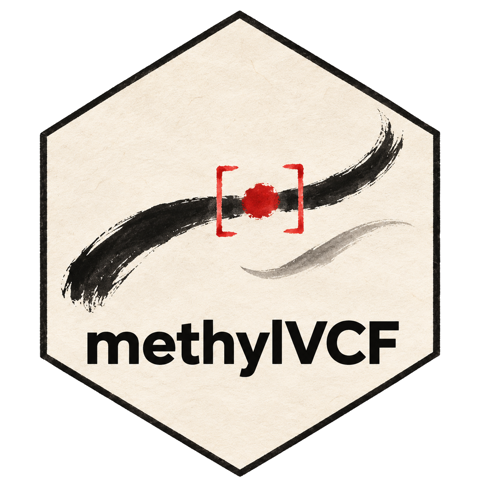

---
output:
    github_document:
        html_preview: false
---

<!-- README.md is generated from README.Rmd. Edit README.Rmd. -->

```{r setup, include=FALSE}
knitr::opts_chunk$set(collapse = TRUE, comment = "#>")
pkgload::load_all(quiet = TRUE, export_all = FALSE)
```

# methylVCF 

<!-- badges: start -->
[![R CMD check on devel][ci-badge]][ci]
[![MIT license][license-badge]][license]
<!-- badges: end -->

**DNA methylation from VCF and gVCF, by genomic region.**

methylVCF reads 5mC measurements reported by Illumina DRAGEN 5-Base and
Rastair. Work with individual measurements as `GRanges`, or assemble
reference methylation across samples in a `RangedSummarizedExperiment`.

## Installation

Requires R 4.6 or later.

### Development version

Install from [GitHub](https://github.com/xec-cm/methylVCF) with pak.

```{r install-devel, eval=FALSE}
pak::pak("xec-cm/methylVCF")
```

### Bioconductor

This installation will be available once methylVCF is published on
Bioconductor.

```{r install-bioc, eval=FALSE}
BiocManager::install("methylVCF")
```

## Quick start

The examples use plyranges for genomic ranges and tidySummarizedExperiment
for site-by-sample tables. Install the companions to run the tutorials.

```{r install-tidy, eval=FALSE}
BiocManager::install(c("plyranges", "tidySummarizedExperiment"))
```

Use `inspectMethylVcf()` to check sample names, methylation fields and index
readability before a regional query.

Build a one-base interval with plyranges and read the reported
measurements from a bundled DRAGEN gVCF.

```{r quick-start}
library(methylVCF)

vcf <- system.file("extdata", "dragen-multisample.g.vcf", package = "methylVCF")
site <-
    tibble::tibble(seqnames = "chr21", start = 13204474L, width = 1L) |>
    plyranges::as_granges()

readMethylVcf(vcf, site) |>
    tibble::as_tibble() |>
    dplyr::select(seqnames, start, sample, fraction, informative_depth)
```

Use `plyranges::join_overlap_inner()` to annotate calls with genomic
features. For aligned reference measurements, pass the original ranges
to `asMethylExperiment()`. The experiment keeps reported values and
coverage-backed fractions in separate assays.

## Articles

- **Explore methylation in a region** with `vignette("methylVCF")`.
- **Inspect and read your own DRAGEN or Rastair files** with
  `inspectMethylVcf()` and `vignette("input-vcf")`.
- **Reproduce the HG002 case study** with `vignette("dragen-hg002")`.

## Community

- [Report a bug][bug]. Include the caller version and a small reproducible
  genomic query.
- [Suggest a feature][feature]. Describe the input and what you want to
  obtain from it.
- [Contribute to methylVCF](.github/CONTRIBUTING.md). See how to work on the
  package and run the checks locally.

[ci-badge]: https://github.com/xec-cm/methylVCF/actions/workflows/check-bioc.yml/badge.svg?branch=devel
[ci]: https://github.com/xec-cm/methylVCF/actions/workflows/check-bioc.yml?query=branch%3Adevel
[license-badge]: https://img.shields.io/badge/license-MIT-blue.svg
[license]: https://opensource.org/license/mit
[bug]: https://github.com/xec-cm/methylVCF/issues/new?template=bug-report.md
[feature]: https://github.com/xec-cm/methylVCF/issues/new?template=feature_request.md
