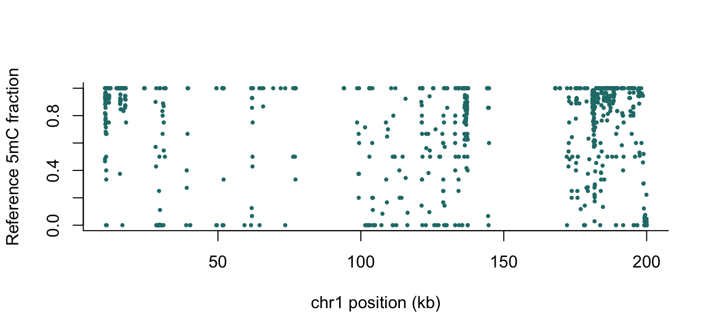

# Introduction

This case study starts with a small indexed DRAGEN example included in the
package. It then shows the same workflow on HG002 and explains how coverage
and phase affect the interpretation of the resulting methylation profile.

# Installation

For the development version, follow the [installation instructions][install].
Once methylVCF is available on Bioconductor, install it with its tutorial
dependencies.

```{r installation, eval=FALSE}
BiocManager::install("methylVCF", dependencies = TRUE)
```

# Query a bundled DRAGEN file with Tabix

Compress the artificial gVCF and create a TBI index in the temporary
directory. Inspect the indexed file and pass the detected format to the
reader. The query starts inside a gVCF reference block, so the measurement
anchor and the source record start differ.

```{r indexed-fixture, message=FALSE}
library(methylVCF)

fixture <- system.file("extdata", "dragen-example.g.vcf", package = "methylVCF")
indexed_file <- tempfile(fileext = ".g.vcf.gz")
invisible(Rsamtools::bgzip(fixture, dest = indexed_file))
index <- Rsamtools::indexTabix(indexed_file, format = "vcf")

info <- inspectMethylVcf(indexed_file)
info$index[c("type", "status")]

site <- GenomicRanges::GRanges("chr21", IRanges::IRanges(13204474L))
local_calls <- readMethylVcf(indexed_file, site, format = info$format)
S4Vectors::metadata(local_calls)$access
as.data.frame(local_calls)[c("start", "record_start", "fraction", "informative_depth")]
```

```{r remove-indexed-fixture, include=FALSE}
unlink(c(indexed_file, index))
```

# Query an HG002 region

Can we inspect reference methylation and phase evidence in a single DRAGEN
gVCF? Here we query a 190 kb window on chromosome 1
(`chr1:10000–200000`, GRCh38). The input comes from Illumina's
5-Base DNA Prep demo for HG002 (NA24385, Sample40, DRAGEN 4.4.6).
The example results use a local indexed excerpt of that file.
[Demo files][demo] · [Validation and provenance][validation]

To run the code, download
`Demo-5base-gDNA-Sample40-NA24385-50ng-B-C02.hard-filtered.gvcf.gz`
and keep its matching `.tbi` beside it. An indexed excerpt also works
if it contains the header and all overlapping records. Set the local
path before running this article from a checkout with methylVCF
installed. The worked example uses plyranges to select genomic regions
and tidySummarizedExperiment to view the reference assays. Leave the
variable unset to build the article with the recorded results.

```{r run-hg002, eval=FALSE}
Sys.setenv(METHYLVCF_HG002 = "/path/to/HG002.gvcf.gz")
rmarkdown::render("vignettes/dragen-hg002.Rmd")
```

```{r setup, include=FALSE}
hg002 <- Sys.getenv("METHYLVCF_HG002")
run_hg002 <- nzchar(hg002)
```

```{r hg002-import, eval=run_hg002}
library(tidySummarizedExperiment)

info <- inspectMethylVcf(hg002, format = "dragen")
info$index[c("type", "status")]

region <-
    tibble::tibble(seqnames = "chr1", start = 10000L, end = 200000L) |>
    plyranges::as_granges()

calls <- readMethylVcf(hg002, region, format = info$format, on_problem = "report")
calls |>
    tibble::as_tibble() |>
    dplyr::count(scope, coverage_status)

nrow(S4Vectors::metadata(calls)$diagnostics)
```

The interval returned **1,992 measurements**. Of these, 1,135 had
observed fractions and 857 had zero informative depth. There were
1,969 pooled, 20 allele-level and 3 haplotype-level measurements.
No import diagnostics were recorded. The uncompressed version of the
same excerpt yielded identical rows by sequential access.

# Plot the reference methylation profile

Project the pooled reference measurements onto a common set of reference
sites. The resulting experiment has 1,771 sites in one sample, with
1,055 coverage-backed fractions. Plot the observed fractions along the
chromosome. Each dot is one measured CpG anchor. Omitted positions
include sites with zero informative depth.

```{r hg002-profile, eval=run_hg002, warning=FALSE, fig.width=7, fig.height=3.3, dev.args=list(bg="transparent"), crop=NULL, fig.alt="Reference CpG methylation fractions along the HG002 interval."}
experiment <- asMethylExperiment(calls)
profile <-
    experiment |>
    tibble::as_tibble() |>
    dplyr::filter(!is.na(fraction)) |>
    dplyr::mutate(position_kb = start / 1000)

graphics::plot(
    fraction ~ position_kb, data = profile, ylim = c(0, 1),
    pch = 16, cex = 0.55, col = "#247A78", bty = "l",
    xlab = "chr1 position (kb)", ylab = "Reference 5mC fraction"
)
```

```{r hg002-recorded-profile, eval=!run_hg002, echo=FALSE, crop=NULL, fig.alt="Reference CpG methylation fractions along the HG002 interval."}

```

# Inspect what one measurement means

Use the original ranges to inspect allele assignment. The cases below
cover one block and several variant or coverage situations.

```{r hg002-rows, eval=run_hg002}
anchors <-
    tibble::tibble(
        seqnames = "chr1",
        start = c(10493L, 10816L, 28692L, 94011L, 171535L),
        width = 1L
    ) |> plyranges::as_granges()

calls |>
    plyranges::filter_by_overlaps(anchors) |>
    tibble::as_tibble() |>
    dplyr::select(
        start,
        record_start,
        genotype,
        allele_index,
        haplotype,
        scope,
        fraction,
        informative_depth
    )
```

| Anchor | What the call represents | Fraction | Reads |
| ---: | --- | ---: | ---: |
| 10,493 | REF CpG inside the block starting at 10,486 | 0.4839 | 31 |
| 10,816 | Pooled REF with no informative reads | 0 | 0 |
| 28,692 | REF on phased slot 1 | 0 | 14 |
| 94,011 | ALT in an unphased heterozygote | 0.9286 | 14 |
| 171,535 | ALT pooled across both copies of a phased homozygote | 0.7692 | 13 |

The zero at 28,692 is backed by 14 reads. The zero at 10,816 is the
caller-reported value at zero depth. The ALT measurements at 94,011 and
171,535 both have `haplotype = NA`, for different reasons: the first
genotype is unphased and the second measurement pools both copies.

A phased or heterozygous genotype alone does not establish a REF/ALT
methylation comparison. In the larger validation excerpt
(`chr1:9998–8007476`), 6,924 heterozygous `PASS` SNVs with one real ALT
allele were checked. Of those, 768 had an active REF mask only, 498 had
an active ALT mask only, and 5,658 had neither. The excerpt provided
no SNV with measurements on both alleles at the same anchor. Check
sequence context before interpreting a missing mask as CpG gain or loss.
[DRAGEN methylation fields][dragen]

For an overview of these objects and how to annotate them, start with
the [regional tutorial](methylVCF.html).

# Session information

```{r session-info}
utils::sessionInfo()
```

[demo]: https://basespace.illumina.com/analyses/864531910/files/ds.48b7596730dd47ef97699b59ccd3641d
[validation]: https://github.com/xec-cm/methylVCF/blob/devel/dev/caller-validation.md
[dragen]: https://illumina.github.io/IlluminaConnectedAnnotationsDocumentation/core-functionality/methylation-annotation/
[install]: https://github.com/xec-cm/methylVCF#installation
